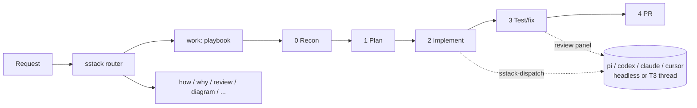
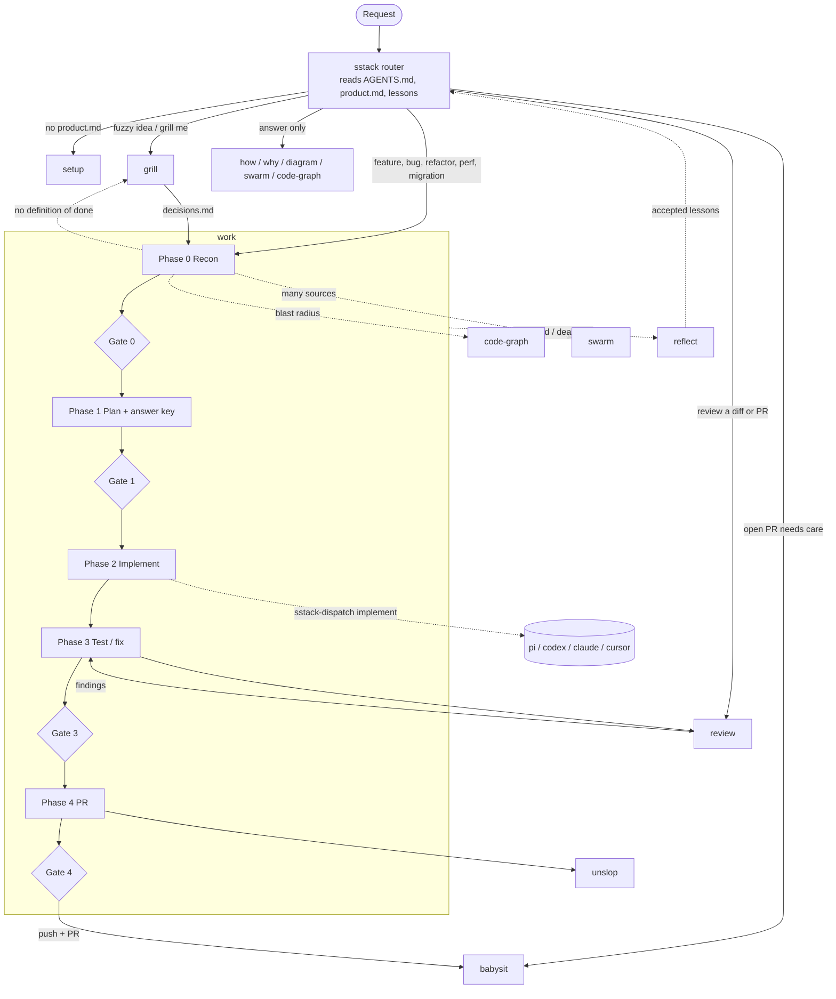

<div align="center">


**A personal skill stack for coding agents: gated workflows, cross-harness routing, and lessons that stick.**


[Overview](#overview) • [Getting started](#getting-started) • [Agent prompts](#agent-prompts) • [Usage](#usage) • [Configuration](#configuration) • [Skills](#skills)

</div>

## Overview

sstack is a set of 13 portable `SKILL.md` skills plus a small stdlib-Python toolkit. It takes an engineering task from "set up this repo" through recon, plan, implement, test, and PR, with a stop for your approval at each gate.

Any phase can be delegated to another harness and model. For example, implement runs on pi + DeepSeek while review runs on a codex + claude panel. A single TOML file controls the routing.

- **One entry point.** The `sstack` skill routes each request to the right skill or playbook. It also loads repo context and accepted lessons, and enforces the verification and delegation rules.
- **Gated phases.** `work` runs features, bug fixes, refactors, perf work, and multi-phase migrations through recon → plan → implement → test/fix → PR.
- **Route by role.** `sstack-dispatch` maps the roles `scout`, `investigate`, `plan`, `implement`, and `review` to a harness and model. Delegated runs go through headless CLIs, or become visible threads inside T3 Code.
- **Read-only by default.** Scout, investigate, plan, and review run in read-only mode. The dispatcher warns you if one of them changes the working tree anyway.
- **Lessons that turn into structure.** `reflect` records your corrections as lessons. A lesson seen twice is proposed as an edit to a skill, `AGENTS.md`, or a check, so it stops being just another note.
- **Local dashboard.** `sstack-ui` shows roles, runs, lessons, and the code graph. It runs on 127.0.0.1 and requires a token.

It works in any environment that reads `SKILL.md` folders: Claude Code, Codex, Cursor, pi, T3 Code, Conductor, Orca, or a plain terminal.



## Getting started

### Prerequisites

- Python 3.11 or later. Nothing else is needed for the core.
- The agent CLIs you want to route to, e.g. `pi`, `codex`, `claude`, `cursor-agent`.
- Optional: the `code-review-graph` CLI for the `code-graph` skill, and the `archify` skill for `diagram`.

### Install

```sh
git clone https://github.com/cobeo2004/sstack.git && cd sstack
bin/sstack-install --dry-run   # show what would change
bin/sstack-install             # link the skills and add the router line
```

The installer:

- symlinks `skills/*` into every skill directory that already exists: `~/.claude/skills`, `~/.agents/skills`, `~/.codex/skills`, `~/.cursor/skills`, and `~/.pi/agent/skills`;
- adds one marked line pointing at the `sstack` skill to `~/.claude/CLAUDE.md`, `~/.codex/AGENTS.md`, and `~/.pi/agent/AGENTS.md`;
- copies `config.example.toml` to `~/.sstack/config.toml` if that file doesn't exist.

> [!NOTE]
> If a skill with the same name is already installed, it's renamed to `<name>.bak` and never deleted. `bin/sstack-install --uninstall` removes only sstack's own symlinks and the marked line, then lists any backups left in place.

### Set up a repo

In your agent, open the repo and say "set up this repo". The `setup` skill writes these files:

- `.sstack/product.md`: what the app is;
- `.sstack/config.toml`: repo routing and verify commands;
- the code graph;
- one row in `AGENTS.md`.

## Agent prompts

Prefer to let your coding agent do the setup? Paste one of these into Claude Code, Codex, Cursor, pi or T3 Code. Each block has a copy button on GitHub.

### Install the stack

Run this once per machine, from any directory.

```text
Install sstack (https://github.com/cobeo2004/sstack) on this machine.

1. Ask me where to clone it, then clone it there (or `git pull` if a clone is
   already there). Below, <sstack> means that directory.
2. Check that `python3 --version` is 3.11 or later. Stop and tell me if it isn't.
3. Run `<sstack>/bin/sstack-install --dry-run` and show me the full output.
   Wait for my yes before running `<sstack>/bin/sstack-install` for real.
   Never edit ~/.claude/skills, ~/.codex/skills or similar dirs by hand.
4. Open ~/.sstack/config.toml and list each harness that a role uses (pi, codex,
   claude, cursor-agent). Run `<cli> --version` for each and tell me which are
   missing. Don't install anything.
5. Show which harness and model each role resolves to:
   `<sstack>/bin/sstack-dispatch <role> --brief /dev/null --report /dev/null --dry-run`
   for each of scout, investigate, plan, implement and review. A role that
   prints `local` (exit 3) isn't an error: it runs in your own session.
6. Print the SessionEnd hook snippet the installer showed, and ask me whether I
   want automatic reflect turned on.
```

> [!NOTE]
> Restart your agent after installing so it picks up the new skills.

### Set up a project

Run this inside the repo, new or existing.

```text
Use the sstack skill to set up this repo for sstack (route: setup).

- Existing code: read AGENTS.md / CLAUDE.md, the README and docs first, then
  write .sstack/product.md and .sstack/config.toml from the setup templates.
- Empty or brand-new repo: ask me what the app is, who it's for and the stack
  before writing anything.
- Find the real lint / typecheck / test / build commands and run each one once.
  Put the ones that pass in [project].verify. Show me any that fail.
- Build the code graph if code-review-graph is installed. Otherwise say it was skipped.
- Add the sstack row to AGENTS.md and register the repo for the dashboard.
- Before you write anything, show me the files you'll create or change.
  Don't commit.
- Finish with the setup report: files written, verify results, graph status,
  and anything you couldn't infer.
```

Then give it a first task to check the whole flow end to end:

```text
/work <a small ticket or bug in this repo>
```

## Usage

Ask for the work in plain language: "fix the login redirect bug", "how does billing sync work", "review PR 142". The `sstack` router picks a skill. You can also name one directly, e.g. `/sstack`, `/work`, `/review`.

### Delegate a role

```sh
bin/sstack-dispatch implement --brief .sstack/runs/42/brief.md --report .sstack/runs/42/report.md --title "fix login"
bin/sstack-dispatch implement --brief b.md --report r.md --files web/components/Nav.tsx --dry-run
# route: auto frontend → tier.standard
bin/sstack-dispatch review --brief brief.md --report review.md --dry-run   # show the route without running it
bin/sstack-dispatch review --route --files src/                             # JSON route for T3, runs nothing
bin/sstack-dispatch routes                                                  # tiers, kinds and your hints
```

**Smart routing.** Each dispatch runs one agent, chosen in this order:

1. `--hint <name>` naming a config hint, or a config hint whose `paths` match `--files`.
2. The work kind, from `--hint <kind>` or detected from `--files`: `security` and `complex` → `tier.strong`; `frontend`, `backend` and `mobile` → `tier.standard`; `mechanical` and `docs` → `tier.cheap`. This applies to `implement`, and only when `[tier.*]` is configured.
3. The role's own `[role.*]` config. A role with none runs locally.

A plain `.ts`/`.js`/`.mjs` file is `backend` under `server/`, `api/`, `functions/`, `supabase/` or `db/`, and `frontend` anywhere else. A change where every file is prose is `docs`, even when a path mentions auth; a `security` change ignores path hints that would downgrade it unless the hint sets `override_security = true`. Untracked files under a hidden directory (`.omc/`, `.cache/`) are not counted.

Tiers are yours to define: any `[tier.<name>]` works. `[routing.kinds]` remaps a built-in kind to your tier (`frontend = "ui-fast"`) or adds a kind name for `--hint` (`data = "local-gpu"`). `rules.tier_order` sets the escalation ladder. A hint or remap that names an undefined tier is a config error.

Review runs **one** reviewer, never the implementer's model. It runs the full panel only for `security`/`complex` changes, diffs over `rules.panel_diff_lines` (default 400), or `--panel`. The same `panel` works on any read-only role; on `implement` it is a config error. A failed child is retried once, one tier up `rules.tier_order`, never onto the implementer's model for a review (`rules.auto_escalate`). The failed report is kept as `<report>.failed.md`.

| Exit | Meaning |
|---|---|
| `0` | Success. The report is non-empty. |
| `1` | Failure, empty report, or config error. |
| `2` | Timeout. The whole process group was killed. |
| `3` | The role is local: the agent does the work in its own session. The dispatcher prints `local`. |

Each run is appended to `.sstack/runs/index.jsonl`, with the route it took. For a review panel, `--report` holds an index that links each member's report.
`--route` is for an agent that starts the children itself: it prints `{role, route, readonly, members: [{harness, provider, model, effort, options}]}` and runs nothing (exit `3` with `members: []` means the role is local; `1` is a config error). In T3 Code the agent then calls `delegate_task` once per member, with `options` for effort and `interactionMode: "plan"` for a read-only role, and writes each child's summary to the report itself. See [`skills/sstack/harness-notes/ade.md`](skills/sstack/harness-notes/ade.md).

### Lessons

```sh
bin/sstack-lessons add "Use pnpm, never npm" --evidence "user corrected npm install"
bin/sstack-lessons list --status accepted --scope repo
bin/sstack-lessons accept L1
bin/sstack-lessons encode L1 --target AGENTS.md
```

Lessons live in `.sstack/lessons.md` (repo scope) and `~/.sstack/lessons.md` (global scope), one line each. The router follows only **accepted** lessons.

> [!TIP]
> For automatic reflection, set `[reflect] auto = true` and add the `SessionEnd` hook that `sstack-install` prints. At the end of each session, a background scout reads the transcript and records new lessons as pending, for you to accept.

### Worktree preflight

```sh
bin/sstack-worktree              # branch, behind/ahead of base, dirty, gitignored files missing vs the primary
bin/sstack-worktree copy         # copy only what the primary's .worktreeinclude lists; never overwrites (--dry-run)
```

`work` runs it first in Phase 0. `.worktreeinclude` uses gitignore syntax (the same file Claude Code reads), e.g. `.env` and `.env.local`. Secrets are never copied unless you list them there.

### Before/after media on PRs

```sh
bin/sstack-pr-media 142 .sstack/runs/<run-id>/media/* --edit-body   # add --dry-run to preview
```

Run it right after opening the PR so the table lands in the PR description, never a comment. Comments are only for add-ons (media captured after review, follow-up notes), never the main evidence.

For any change a user can see, the agent captures `before-<step>.png` on the base commit and `after-<step>.png` on the change, plus a recording of the flow. It uses the ADE's capture tools for this. `sstack-pr-media` then:

- pushes the files to a separate `sstack-media` branch, never the PR branch;
- turns videos into inline GIFs when `ffmpeg` is installed;
- prints a marked **Before | After** HTML table with screenshots and Mermaid diagrams side by side; `--edit-body` replaces that section in the PR description.

Backend changes get diagrams instead of screenshots. The agent draws the changed flow from the code as `before-<flow>.mmd` and `after-<flow>.mmd`, as a sequence, flowchart, state or ER diagram. `sstack-pr-media` inlines them as Mermaid blocks, which GitHub renders, and pushes nothing for them.

Publishing is a push, so the agent asks first.

### Dashboard

```sh
bin/sstack-ui            # prints http://127.0.0.1:<port>/?t=<token>
```

The dashboard has these views:

- an overview;
- roles, editable per config layer;
- run history, with links to each report;
- lessons, which you can accept or forget;
- phases and playbooks;
- the code graph, with a rebuild button.

It lists repos from `~/.sstack/repos.txt`.

## Configuration

Config is layered. A later layer wins:

| File | Scope |
|---|---|
| `~/.sstack/config.toml` | Global, installed from [`config.example.toml`](config.example.toml) |
| `<repo>/.sstack/config.toml` | Per repo. Commit it or not. |
| `<repo>/.sstack/config.local.toml` | Personal and git-ignored |

The `[role.*]`, `[harness.*]`, `[tier.*]`, and `[project]` tables are replaced whole. Other tables merge key by key. In a linked worktree a missing `config.toml`, `config.local.toml` or `lessons.md` resolves to the primary checkout's (`git worktree list --porcelain`, first entry); a file the worktree has wins, and runs stay local.

```toml
[tier.strong]                    # security, complex, review
harness = "codex"
model = "gpt-6.1-sol"
[tier.standard]                  # frontend, backend, mobile
harness = "claude"
model = "sonnet"
[tier.cheap]                     # mechanical, docs
harness = "pi"
model = "opencode-go/deepseek-v4.1-flash"

[role.implement]                 # when no kind applies
harness = "pi"
model = "opencode-go/deepseek-v4.1-flash"
effort = "high"

[role.implement.hint.ui]         # optional override: --hint ui, or paths match
when = "our web app"
paths = ["web/*"]
harness = "claude"
model = "opus"

[role.review]
mode = "auto"                    # one reviewer; panel only when risky
panel = [
  { harness = "codex",  model = "gpt-6.1-sol", effort = "high" },
  { harness = "claude", model = "opus" },
]

[rules]
review_not_implementer = true   # drop any panel member identical to role.implement
```

A repo's `[project.test]` table says how each surface is tested: **code** (unit and integration), **browser**, and **mobile**. For each one it records the framework, where tests live, and the run, serve or build commands. `setup` fills it in. [`skills/work/testing.md`](skills/work/testing.md) defines how the agent writes each kind of check, runs it, and proves it. For any change a user can see, the agent also does a live self-check. It drives the app in the ADE's built-in browser or device, and runs the code tests alongside. The ADE can be T3 Code (preview and device panels), Orca (`orca` browser and emulator commands) or Conductor (headless, since its in-app browser is only for you to watch). The per-ADE tools are listed in [`skills/sstack/harness-notes/ade.md`](skills/sstack/harness-notes/ade.md).

A role with no config, or set to `harness = "local"`, runs in the current session. `[transport] mode` chooses how delegated roles run: `auto`, `thread`, `headless`, or `local`. With `auto`, sstack uses T3 Code threads when `T3CODE_THREAD_ID` is set and headless CLIs otherwise.

> [!IMPORTANT]
> Read-only roles (`scout`, `investigate`, `plan`, `review`) run with their harness's `headless_readonly` command, never with write access. Routing one to a harness without that command is a config error: dispatch exits `1`. Every harness in `config.example.toml` has one, cursor included (`cursor-agent -p --mode plan`). Inside T3 Code the agent can instead delegate a read-only role with plan mode, as above.

## Skills

| Skill | Use it for |
|---|---|
| `sstack` | The entry point: routing, gates, verification, delegation rules |
| `setup` | Making a repo agent-ready (`product.md`, config, verify commands, graph) |
| `work` | Features, bug fixes, refactors, perf, multi-phase work through gated phases |
| `grill` | Brainstorming a fuzzy idea or stress-testing a plan, ending in `decisions.md` that `work` runs from |
| `review` | Adversarial review of a diff or PR by a different model family |
| `babysit` | Getting a PR to merge-ready: CI, conflicts, review comments |
| `swarm` | Sending one question to many independent scouts, then combining their reports |
| `how` | How code works, from source, with `file:line` citations |
| `why` | Why code is this way, from history, with each claim tagged by confidence |
| `diagram` | Architecture, sequence, data-flow, and state diagrams grounded in the code |
| `code-graph` | Building the code graph and finding a diff's blast radius |
| `unslop` | Cleaning code slop and AI-sounding prose out of a diff before the PR |
| `reflect` | Turning corrections into lessons, and repeated lessons into structural edits |

How the skills hand off to each other. The `sstack` router picks one; `work` calls the others at fixed phases. Diamonds are gates: they wait for your yes.



The `sstack` skill links eight engineering principles in [`skills/sstack/principles/`](skills/sstack/principles/) and per-harness tool notes in [`skills/sstack/harness-notes/`](skills/sstack/harness-notes/).

## Development

```sh
python3 -m unittest discover -s tests
```

The tests use a temporary HOME and repo, plus a fake agent ([`tests/fakes/fake_agent.py`](tests/fakes/fake_agent.py)), so they never call a real model. [`tests/test_skills.py`](tests/test_skills.py) lints every skill: frontmatter, length caps, harness-neutral wording, and links that resolve.

The full design is in [docs/design.md](docs/design.md).
