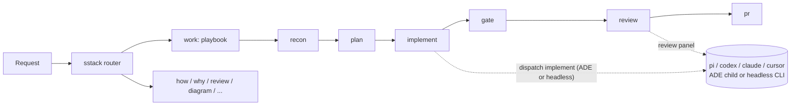
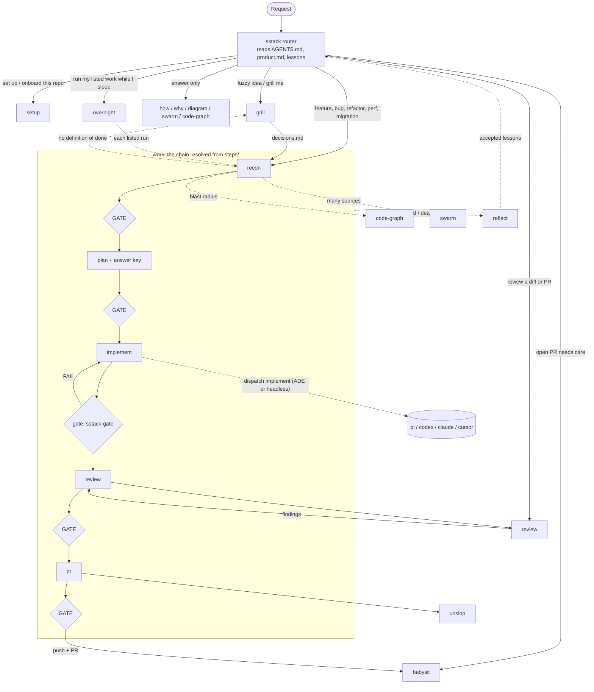

<div align="center">


**A personal skill stack for coding agents: gated workflows, cross-harness routing, and lessons that stick.**


[Overview](#overview) • [Docs](#docs) • [Getting started](#getting-started) • [Agent prompts](#agent-prompts) • [Usage](#usage) • [Configuration](#configuration) • [Skills](#skills)

</div>

## Overview

sstack is a set of 15 portable `SKILL.md` skills plus a small stdlib-Python toolkit. It takes an engineering task from "set up this repo" through recon, plan, implement, test, and PR, with a stop for your approval at each gate.

Any step can be delegated to another harness and model. For example, implement runs on pi + DeepSeek while review runs on a codex + claude panel. Small TOML files, one per role, harness, tier and ADE, control the routing.

- **One entry point.** The `sstack` skill routes each request to the right skill or playbook. It also loads repo context and accepted lessons, and enforces the verification and delegation rules.
- **Gated steps.** The workflow is a chain of step folders (`steps/<name>/step.toml`) resolved across four config layers, so a repo can add, disable, reorder or re-gate a step. Out of the box, `work` runs features, bug fixes, refactors, perf work, and multi-phase migrations through recon → plan → implement → gate → review → pr.
- **A gate that means it.** `sstack-gate` runs the base branch's `verify` commands, blocks edits to protected files, and with `--pr` requires before/after evidence.
- **Route by role.** `sstack-dispatch` maps the roles `scout`, `investigate`, `plan`, `implement`, and `review` to a harness and model. Inside an ADE (T3 Code, Orca, Conductor) a delegated run becomes that ADE's own child task; elsewhere it runs a headless CLI.
- **Read-only by default.** Scout, investigate, plan, and review run in read-only mode. The dispatcher warns you if one of them changes the working tree anyway.
- **Lessons that turn into structure.** `reflect` records your corrections as lessons. A lesson seen twice is proposed as an edit to a skill, `AGENTS.md`, or a check, so it stops being just another note. Repo lessons land in one `## Things agents get wrong` section of `AGENTS.md`, each naming the check that enforces it.
- **Intent you can trace.** `grill` writes numbered requirements (`R1..Rn`) with the problem, who it affects and the constraints. `work` makes every plan step and every check cite one, and an uncovered requirement blocks the plan gate. Review findings are `Important` or `Nit` on a 1–10 rubric; a verified `Important`, or a score below the step's `min_score`, blocks.
- **The repo's own rules first.** Every brief points the child at the `AGENTS.md` files down to the paths it touches, the repo's docs, and the nearest similar file to copy. Review's compliance lens cites the rule a finding breaks.
- **Local dashboard.** `sstack-ui` edits config per layer and shows the active ADE, run timelines, lessons and the code graph. It runs on 127.0.0.1 and requires a token.
- **Doctor.** `sstack-doctor` checks the config; `sstack-doctor --smoke` sends a canary through every routed role.

It works in any environment that reads `SKILL.md` folders: Claude Code, Codex, Cursor, pi, T3 Code, Conductor, Orca, or a plain terminal.



## Docs

The guides in [`docs/guide/`](docs/guide/) are written for people and agents alike: each has
commands you can run as-is, their expected output and exit codes, and a "How to change this"
section.

- [Getting started](docs/guide/getting-started.md): install, check, first dispatch.
- [Configuration](docs/guide/configuration.md): split layout, four layers, merge rules, migrate, `sstack-config show`.
- [The workflow](docs/guide/workflow.md): step folders, a custom step, `min_score`, disabling a step.
- [The gate](docs/guide/gate.md): deterministic `verify`, protected files, and PR evidence checks.
- [Overnight](docs/guide/overnight.md): running the runs you list while you sleep, and the `[overnight]` merge policy.
- [ADEs](docs/guide/ades.md): built-in adapters, detection order, `SSTACK_ADE`, capabilities.
- [Writing an ADE adapter](docs/guide/writing-an-ade.md): TOML schema, hook JSON contract, worked examples.
- [Dispatch](docs/guide/dispatch.md): roles, panels, `via`, exit codes 0–5, `record`, run records, the write lock.
- [Doctor and smoke test](docs/guide/doctor.md): static checks and the canary smoke test.
- [Dashboard](docs/guide/dashboard.md): the local config and runs cockpit and its API.
- [Contributing](docs/guide/contributing.md): repo layout, tests, spec-first rule, PR rules.

Contracts live in [`docs/spec/`](docs/spec/).

## Getting started

```sh
git clone https://github.com/cobeo2004/sstack.git ~/sstack
~/sstack/bin/sstack-install --dry-run   # show what would change
~/sstack/bin/sstack-install             # link the skills and add the router line
```

Prerequisites, what the installer changes, checking the install and a first dispatch:
[docs/guide/getting-started.md](docs/guide/getting-started.md).

## Agent prompts

Prefer to let your coding agent do the setup? Paste one of these into Claude Code, Codex, Cursor, pi or T3 Code. Each block has a copy button on GitHub.

### Install the stack

Run this once per machine, from any directory.

```text
Install sstack (https://github.com/cobeo2004/sstack) on this machine.

1. Ask me where to clone it, then clone it there (or `git pull` if a clone is
   already there). Below, <sstack> means that directory.
2. Check that `python3 --version` is 3.11 or later. Stop and tell me if it isn't.
3. Run `<sstack>/bin/sstack-install --dry-run` and show me the full output.
   Wait for my yes before running `<sstack>/bin/sstack-install` for real.
   Never edit ~/.claude/skills, ~/.codex/skills or similar dirs by hand.
4. Run `<sstack>/bin/sstack-doctor` and show me the output. A `FAIL harness CLIs`
   line names the agent CLIs that are missing. Don't install anything. If it
   says legacy config, ask me, then run `<sstack>/bin/sstack-config migrate`.
5. Show which harness and model each role resolves to:
   `<sstack>/bin/sstack-dispatch <role> --brief /dev/null --report /dev/null --dry-run`
   for each of scout, investigate, plan, implement and review. A role that
   prints `local` (exit 3) isn't an error: it runs in your own session.
6. Print the SessionEnd hook snippet the installer showed, and ask me whether I
   want automatic reflect turned on.
```

> [!NOTE]
> Restart your agent after installing so it picks up the new skills.

### Set up a project

Run this inside the repo, new or existing.

```text
Use the sstack skill to set up this repo for sstack (route: setup).

- Existing code: read AGENTS.md / CLAUDE.md, the README and docs first, then
  write .sstack/product.md and .sstack/project.toml from the setup templates.
- Empty or brand-new repo: ask me what the app is, who it's for and the stack
  before writing anything.
- Find the real lint / typecheck / test / build commands and run each one once.
  Put the ones that pass in `verify` in .sstack/project.toml. Show me any that fail.
- Build the code graph if code-review-graph is installed. Otherwise say it was skipped.
- Add the sstack row to AGENTS.md and register the repo for the dashboard.
- Before you write anything, show me the files you'll create or change.
  Don't commit.
- Finish with the setup report: files written, verify results, graph status,
  and anything you couldn't infer.
```

Then give it a first task to check the whole flow end to end:

```text
/work <a small ticket or bug in this repo>
```

## Usage

Ask for the work in plain language: "fix the login redirect bug", "how does billing sync work", "review PR 142". The `sstack` router picks a skill. You can also name one directly, e.g. `/sstack`, `/work`, `/review`.

### Delegate a role

```sh
bin/sstack-dispatch implement --brief .sstack/runs/42/brief.md --report .sstack/runs/42/report.md --title "fix login"
bin/sstack-dispatch implement --brief b.md --report r.md --files web/components/Nav.tsx --dry-run
# route: auto frontend → tier.standard
bin/sstack-dispatch review --brief brief.md --report review.md --dry-run   # show the route without running it
bin/sstack-dispatch routes                                                  # tiers, kinds and your hints
bin/sstack-dispatch ade                                                     # the active ADE, why, its capabilities
```

Each dispatch picks a harness and model from the role's config, a hint, or the work kind; inside an
ADE it becomes that ADE's child task, else a headless CLI. It exits `0` (report written), `1`
(failure), `2` (timeout), `3` (run locally) or `4` (the agent must make the printed tool calls,
then run each `sstack-dispatch record` line). Each run gets a dir under `.sstack/runs/` and a line
in `.sstack/runs/index.jsonl`. Details: [docs/guide/dispatch.md](docs/guide/dispatch.md) and
[docs/guide/ades.md](docs/guide/ades.md).

### Lessons

```sh
bin/sstack-lessons add "Use pnpm, never npm" --evidence "user corrected npm install"
bin/sstack-lessons add "Migrations need a rollback" --path "db/migrations/**"
bin/sstack-lessons list --status accepted --scope repo
bin/sstack-lessons list --status accepted --paths web/app.tsx lib/x.py
bin/sstack-lessons accept L1
bin/sstack-lessons encode L1 --target AGENTS.md
```

Lessons live in `.sstack/lessons.md` (repo scope) and `~/.sstack/lessons.md` (global scope), one line each. The router follows only **accepted** lessons.

A lesson can be pinned to path globs (`--path`, repeatable) and records the commit it was learned at. `list --paths <file>...` keeps the lessons about those files — a lesson with no `path` always applies — and marks `[stale]` a lesson whose paths changed since its commit, to re-check before following it.

> [!TIP]
> For automatic reflection, set `[reflect] auto = true` and add the `SessionEnd` hook that `sstack-install` prints. At the end of each session, a background scout reads the transcript and records new lessons as pending, for you to accept.

### Worktree preflight

```sh
bin/sstack-worktree              # branch, behind/ahead of base, dirty, gitignored files missing vs the primary
bin/sstack-worktree copy         # copy only what the primary's .worktreeinclude lists; never overwrites (--dry-run)
```

`work` runs it first, in the `recon` step. `.worktreeinclude` uses gitignore syntax (the same file Claude Code reads), e.g. `.env` and `.env.local`. Secrets are never copied unless you list them there.

### Before/after media on PRs

```sh
bin/sstack-pr-media 142 .sstack/runs/<run-id>/media/* --edit-body   # add --dry-run to preview
```

Run it right after opening the PR so the table lands in the PR description, never a comment. Comments are only for add-ons (media captured after review, follow-up notes), never the main evidence.

For any change a user can see, the agent captures `before-<step>.png` on the base commit and `after-<step>.png` on the change, plus a recording of the flow. It uses the ADE's capture tools for this. `sstack-pr-media` then:

- pushes the files to a separate `sstack-media` branch, never the PR branch;
- turns videos into inline GIFs when `ffmpeg` is installed;
- prints a marked **Before | After** HTML table with screenshots and Mermaid diagrams side by side; `--edit-body` replaces that section in the PR description.

Backend changes get diagrams instead of screenshots. The agent draws the changed flow from the code as `before-<flow>.mmd` and `after-<flow>.mmd`, as a sequence, flowchart, state or ER diagram. `sstack-pr-media` inlines them as Mermaid blocks, which GitHub renders, and pushes nothing for them.

Publishing is a push, so the agent asks first.

### Dashboard

```sh
bin/sstack-ui            # prints http://127.0.0.1:<port>/?t=<token>
```

It edits config per layer and shows the active ADE, run timelines, lessons and the code graph.
See [docs/guide/dashboard.md](docs/guide/dashboard.md).

## Configuration

Config is split into one file per thing, in four layers. A later layer wins:

| Layer | Dir |
|---|---|
| defaults | [`<sstack>/defaults/`](defaults/) (built-in; don't edit) |
| home | `~/.sstack/` (or `$SSTACK_HOME`) |
| repo | `<repo>/.sstack/` |
| local | `<repo>/.sstack/local/` (personal, git-ignored) |

Each layer holds one TOML file per thing (`roles/implement.toml` holds `harness = "pi"`), plus a
`config.toml` merged key by key. An old single-file config is an error naming
`sstack-config migrate`.

```sh
bin/sstack-config show roles/review   # the effective file and the layer it comes from
bin/sstack-config migrate --dry-run   # split an old single-file config.toml (keeps a .bak)
bin/sstack-doctor                     # static checks: PASS|FAIL per line, exit 0/1
bin/sstack-doctor --smoke             # canary dispatch per routed member; ask the user first
```

Details: [docs/guide/configuration.md](docs/guide/configuration.md) and
[docs/guide/doctor.md](docs/guide/doctor.md). Read-only roles (`scout`, `investigate`, `plan`,
`review`) always run with their harness's `headless_readonly` command, and `record` warns when one
changes the tree.

A repo's `project.toml` also says how each surface (code, browser, mobile) is tested; `setup` fills
it in and [`skills/work/testing.md`](skills/work/testing.md) defines how the agent writes, runs and
proves each kind of check.

## Skills

| Skill | Use it for |
|---|---|
| `sstack` | The entry point: routing, gates, verification, delegation rules |
| `setup` | Making a repo agent-ready (`product.md`, config, verify commands, graph) |
| `work` | Features, bug fixes, refactors, perf, multi-phase work through the repo's gated steps |
| `grill` | Brainstorming a fuzzy idea or stress-testing a plan, ending in `decisions.md` that `work` runs from |
| `review` | Adversarial review of a diff or PR by a different model family |
| `babysit` | Getting a PR to merge-ready: CI, conflicts, review comments |
| `overnight` | Running the runs you list at bedtime: gates answered for that session, PRs merged only where policy allows, a report in the morning |
| `swarm` | Sending one question to many independent scouts, then combining their reports |
| `how` | How code works, from source, with `file:line` citations |
| `why` | Why code is this way, from history, with each claim tagged by confidence |
| `diagram` | Architecture, sequence, data-flow, and state diagrams grounded in the code |
| `code-graph` | Building the code graph and finding a diff's blast radius |
| `practices` | Finding best-practice skills and docs for the repo's stack, linked in `.sstack/project.toml` `[practices]` |
| `unslop` | Cleaning code slop and AI-sounding prose out of a diff before the PR |
| `reflect` | Turning corrections into lessons, and repeated lessons into structural edits |

How the skills hand off to each other. The `sstack` router picks one; `work` calls the others at fixed steps. Diamonds are gates: they wait for your yes. Step names below are the built-in defaults; `sstack-workflow show` prints the chain a repo actually has.



The `sstack` skill links eight engineering principles in [`skills/sstack/principles/`](skills/sstack/principles/) and per-harness tool notes in [`skills/sstack/harness-notes/`](skills/sstack/harness-notes/).

## Development

```sh
python3 -m unittest discover -s tests
```

The tests use a temporary HOME and repo and fake agent CLIs, so they never call a real model. See
[docs/guide/contributing.md](docs/guide/contributing.md) for the layout, the spec-first rule and
PR rules. The design history is in [docs/design.md](docs/design.md).
