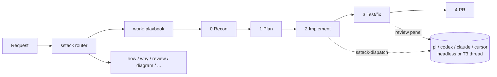

<div align="center">


**A personal skill stack for coding agents: gated workflows, cross-harness routing, and lessons that stick.**


[Overview](#overview) • [Getting started](#getting-started) • [Usage](#usage) • [Configuration](#configuration) • [Skills](#skills)

</div>

## Overview

sstack is a set of 12 portable `SKILL.md` skills plus a small stdlib-Python toolkit. It takes an engineering task from "set up this repo" through recon, plan, implement, test, and PR, with a stop for your approval at each gate.

Any phase can be delegated to another harness and model. For example, implement runs on pi + DeepSeek while review runs on a codex + claude panel. A single TOML file controls the routing.

- **One entry point.** The `sstack` skill routes each request to the right skill or playbook. It also loads repo context and accepted lessons, and enforces the verification and delegation rules.
- **Gated phases.** `work` runs features, bug fixes, refactors, perf work, and multi-phase migrations through recon → plan → implement → test/fix → PR.
- **Route by role.** `sstack-dispatch` maps the roles `scout`, `investigate`, `plan`, `implement`, and `review` to a harness and model. Delegated runs go through headless CLIs, or become visible threads inside T3 Code.
- **Read-only by default.** Scout, investigate, plan, and review run in read-only mode. The dispatcher warns you if one of them changes the working tree anyway.
- **Lessons that turn into structure.** `reflect` records your corrections as lessons. A lesson seen twice is proposed as an edit to a skill, `AGENTS.md`, or a check, so it stops being just another note.
- **Local dashboard.** `sstack-ui` shows roles, runs, lessons, and the code graph. It runs on 127.0.0.1 and requires a token.

It works in any environment that reads `SKILL.md` folders: Claude Code, Codex, Cursor, pi, T3 Code, Conductor, Orca, or a plain terminal.



## Getting started

### Prerequisites

- Python 3.11 or later. Nothing else is needed for the core.
- The agent CLIs you want to route to, e.g. `pi`, `codex`, `claude`, `cursor-agent`.
- Optional: the `code-review-graph` CLI for the `code-graph` skill, and the `archify` skill for `diagram`.

### Install

```sh
git clone <this repo> ~/Codes/sstack && cd ~/Codes/sstack
bin/sstack-install --dry-run   # show what would change
bin/sstack-install             # link the skills and add the router line
```

The installer:

- symlinks `skills/*` into every skill directory that already exists: `~/.claude/skills`, `~/.agents/skills`, `~/.codex/skills`, `~/.cursor/skills`, and `~/.pi/agent/skills`;
- adds one marked line pointing at the `sstack` skill to `~/.claude/CLAUDE.md`, `~/.codex/AGENTS.md`, and `~/.pi/agent/AGENTS.md`;
- copies `config.example.toml` to `~/.sstack/config.toml` if that file doesn't exist.

> [!NOTE]
> If a skill with the same name is already installed, it's renamed to `<name>.bak` and never deleted. `bin/sstack-install --uninstall` removes only sstack's own symlinks and the marked line, then lists any backups left in place.

### Set up a repo

In your agent, open the repo and say "set up this repo". The `setup` skill writes these files:

- `.sstack/product.md`: what the app is;
- `.sstack/config.toml`: repo routing and verify commands;
- the code graph;
- one row in `AGENTS.md`.

## Usage

Ask for the work in plain language: "fix the login redirect bug", "how does billing sync work", "review PR 142". The `sstack` router picks a skill. You can also name one directly, e.g. `/sstack`, `/work`, `/review`.

### Delegate a role

```sh
bin/sstack-dispatch implement --brief .sstack/runs/42/brief.md --report .sstack/runs/42/report.md --title "fix login"
bin/sstack-dispatch review --brief brief.md --report review.md --dry-run   # show the route without running it
```

| Exit | Meaning |
|---|---|
| `0` | Success. The report is non-empty. |
| `1` | Failure, empty report, or config error. |
| `2` | Timeout. The whole process group was killed. |
| `3` | The role is local: the agent does the work in its own session. The dispatcher prints `local`. |

Each run is appended to `.sstack/runs/index.jsonl`. For a review panel, `--report` holds an index that links each member's report.

### Lessons

```sh
bin/sstack-lessons add "Use pnpm, never npm" --evidence "user corrected npm install"
bin/sstack-lessons list --status accepted --scope repo
bin/sstack-lessons accept L1
bin/sstack-lessons encode L1 --target AGENTS.md
```

Lessons live in `.sstack/lessons.md` (repo scope) and `~/.sstack/lessons.md` (global scope), one line each. The router follows only **accepted** lessons.

> [!TIP]
> For automatic reflection, set `[reflect] auto = true` and add the `SessionEnd` hook that `sstack-install` prints. At the end of each session, a background scout reads the transcript and records new lessons as pending, for you to accept.

### Dashboard

```sh
bin/sstack-ui            # prints http://127.0.0.1:<port>/?t=<token>
```

The dashboard has these views:

- an overview;
- roles, editable per config layer;
- run history, with links to each report;
- lessons, which you can accept or forget;
- phases and playbooks;
- the code graph, with a rebuild button.

It lists repos from `~/.sstack/repos.txt`.

## Configuration

Config is layered. A later layer wins:

| File | Scope |
|---|---|
| `~/.sstack/config.toml` | Global, installed from [`config.example.toml`](config.example.toml) |
| `<repo>/.sstack/config.toml` | Per repo. Commit it or not. |
| `<repo>/.sstack/config.local.toml` | Personal and git-ignored |

The `[role.*]`, `[harness.*]`, and `[project]` tables are replaced whole. Other tables merge key by key.

```toml
[role.implement]
harness = "pi"
model = "opencode-go/deepseek-v4.1-flash"
effort = "high"

[role.review]
panel = [
  { harness = "codex",  model = "gpt-6.1-sol", effort = "high" },
  { harness = "claude", model = "opus" },
]

[rules]
review_not_implementer = true   # drop any panel member identical to role.implement
```

A role with no config, or set to `harness = "local"`, runs in the current session. `[transport] mode` chooses how delegated roles run: `auto`, `thread`, `headless`, or `local`. With `auto`, sstack uses T3 Code threads when `T3CODE_THREAD_ID` is set and headless CLIs otherwise.

> [!IMPORTANT]
> Read-only roles (`scout`, `investigate`, `plan`, `review`) always run headless with their harness's `headless_readonly` command, even inside T3 Code. Routing one to a harness without that command (for example `cursor`) is a config error: dispatch exits `1` instead of running it with write access.

## Skills

| Skill | Use it for |
|---|---|
| `sstack` | The entry point: routing, gates, verification, delegation rules |
| `setup` | Making a repo agent-ready (`product.md`, config, verify commands, graph) |
| `work` | Features, bug fixes, refactors, perf, multi-phase work through gated phases |
| `review` | Adversarial review of a diff or PR by a different model family |
| `babysit` | Getting a PR to merge-ready: CI, conflicts, review comments |
| `swarm` | Sending one question to many independent scouts, then combining their reports |
| `how` | How code works, from source, with `file:line` citations |
| `why` | Why code is this way, from history, with each claim tagged by confidence |
| `diagram` | Architecture, sequence, data-flow, and state diagrams grounded in the code |
| `code-graph` | Building the code graph and finding a diff's blast radius |
| `unslop` | Cleaning code slop and AI-sounding prose out of a diff before the PR |
| `reflect` | Turning corrections into lessons, and repeated lessons into structural edits |

The `sstack` skill links eight engineering principles in [`skills/sstack/principles/`](skills/sstack/principles/) and per-harness tool notes in [`skills/sstack/harness-notes/`](skills/sstack/harness-notes/).

## Development

```sh
python3 -m unittest discover -s tests
```

The tests use a temporary HOME and repo, plus a fake agent ([`tests/fakes/fake_agent.py`](tests/fakes/fake_agent.py)), so they never call a real model. [`tests/test_skills.py`](tests/test_skills.py) lints every skill: frontmatter, length caps, harness-neutral wording, and links that resolve.

The full design is in [docs/design.md](docs/design.md).
