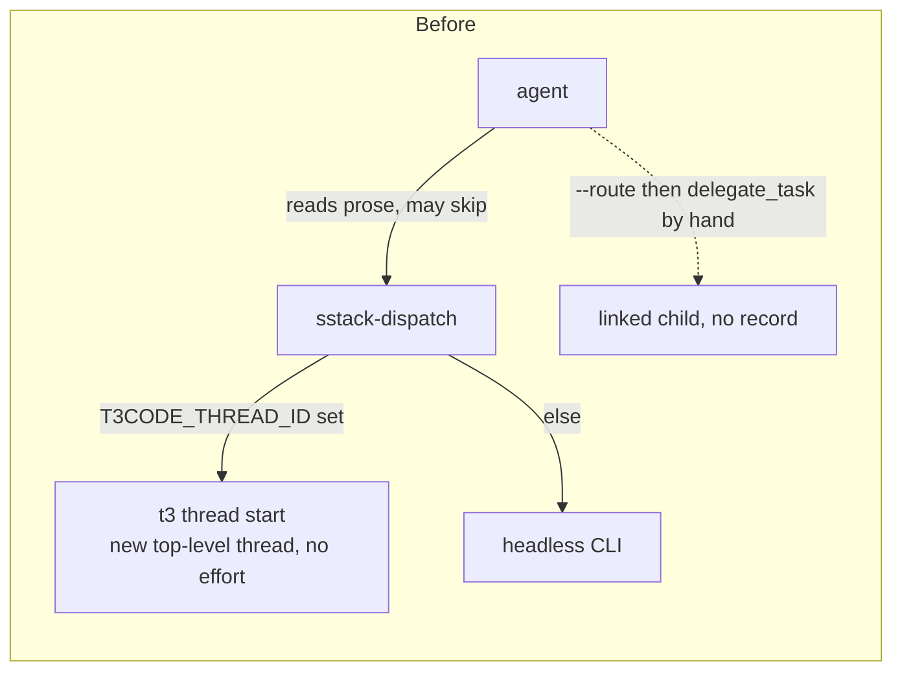
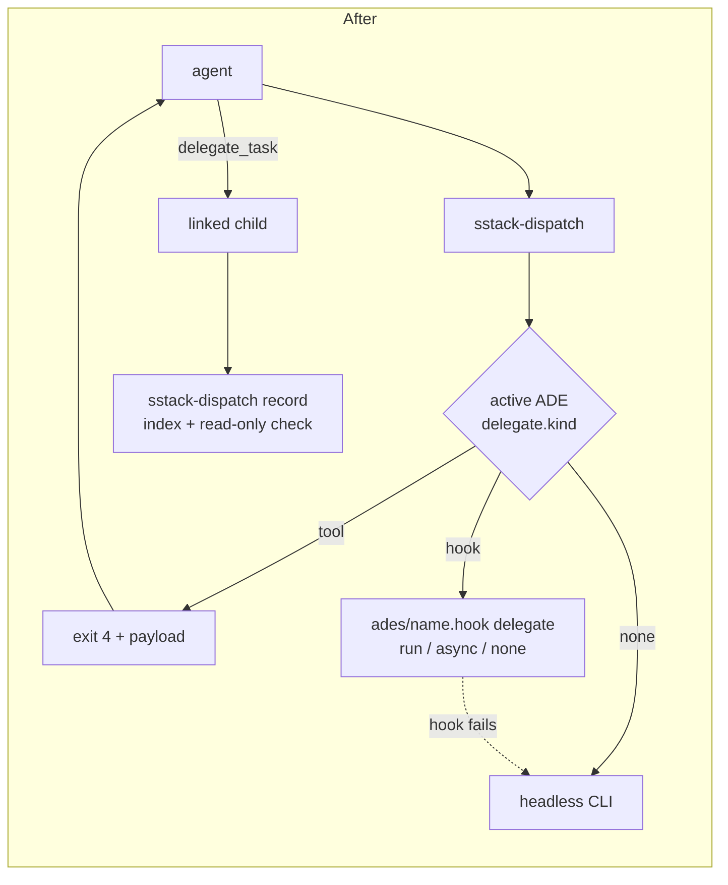

# sstack — design

Date: 2026-11-08. Status: approved by the user 2026-11-08 (with the `reflect`
skill and dashboard added after review). Items marked *(builder's call)* were
settled by the author, not the user. Revised 2026-11-09 (ADE/config redesign): split
config in four layers, ADE adapters, exit 4 + `record`, `sstack-config`, `sstack-doctor`.
Contracts live in [`spec/`](spec/); where this doc and a spec differ, the spec wins.

## Intent

One small skill stack that replaces the overlapping workflow layers the user runs
today (oh-my-claudecode, oh-my-codex, superpowers, phased-work, delegation-brief,
loose process skills). Today the workflow is scattered across those layers, a
CLAUDE.md rule has to referee them, every repo starts cold because nothing sets a
project up, and almost all delegated work lands on Claude even when another model
is better or cheaper (the main case: implementation on pi with DeepSeek).

sstack covers the workflow end to end: **set up a repo → do the work through gated
phases → utilities (diagrams, code graphs)**, with every delegated role routable to
a configured harness + model, from any ADE (T3 Code, Conductor, Orca, Cursor, a
plain terminal).

It will be edited almost daily, so it stays small and swappable: plain folders, no
build step, no generated files.

## Goals

- One entry point that routes any engineering request to the right skill/playbook.
- `setup` that makes a new or existing repo agent-ready, including a short product
  brief ("what this app is and does"), not just conventions.
- `work`: gated phases for any task (ticket ID optional) — debugging, features,
  refactors, perf, executing a plan.
- Per-role harness + model routing from TOML, defaults → global → repo → local.
- Works in any ADE: the ADE's own linked child task where it has one (T3, Orca,
  Conductor), headless CLI everywhere else.
- Learns: captures the user's corrections and the agent's dead ends as lessons so
  they are not repeated, and turns repeated lessons into real edits.
- A light local dashboard showing lessons, code graph, roles/models (editable),
  workflows and runs — built so new pages are easy to add.
- Proven on UniBuz (`/Users/cobeo/Codes/WorkPlace/UniBuz/Unibuz_mobile`).

## Non-goals

- Domain skills (impeccable, Rust, Supabase, ElevenLabs, Vercel/React, dataviz…).
  They stay installed outside sstack and update from their own sources.
- Worktree management — the ADEs own it.
- Data charts — `dataviz` covers them.
- Vector/embedding memory stores, autopilot/autonomous loops, eval machinery,
  provenance/credits tooling, CI-enforced policy. (Lessons are plain files.)

## Anti-goals (failure even if it works)

- Drift: re-growing into a layer that needs refereeing. A new skill is added only
  if it is frequent and not a step of an existing skill.
- A routed child approving its own gate, committing, or opening a PR.
- Restating in prose what the repo already encodes (versions, env names, deps).
- Hard-coding Claude-only mechanics (Agent/Task tool names, plan mode,
  AskUserQuestion) in a skill body, so it breaks under Codex, pi or Cursor.
- Deleting the user's existing skills/plugins without a backup and an explicit yes.

## Constraints

- Python ≥ 3.11 stdlib only for scripts (`tomllib`, `subprocess` with timeout —
  macOS has no `timeout` binary). No npm/pip installs.
- Every SKILL.md readable by Claude Code, Codex, Cursor and pi. Harness-specific
  tool names live in one mapping note per harness, not in skill bodies.
- Gates always stay with the orchestrating session (the one the user talks to).

## Repo layout

```
sstack/
  skills/
    sstack/        SKILL.md  principles/  harness-notes/{claude,codex,cursor,pi}.md
    setup/         SKILL.md  (+ templates for product.md, config.toml)
    work/          SKILL.md  playbooks/{feature,bug-fix,refactor,perf,multi-phase}.md
    swarm/  review/  unslop/  babysit/  how/  why/  diagram/  code-graph/  reflect/
  bin/
    sstack-dispatch     # the router/launcher (Python, stdlib)
    sstack-config       # show / migrate the layered config
    sstack-doctor       # static checks + smoke test
    sstack-install      # symlinks skills into each harness's skills dir
    sstack-ui           # local dashboard server (Python stdlib http.server)
  defaults/             # built-in config layer: config.toml, harnesses/, roles/, ades/
  lib/                  # the Python behind bin/
  ui/                   # dashboard: index.html + ES modules per page, no build step
  docs/design.md  docs/spec/
  tests/                # one small stdlib test file for sstack-dispatch
```

**Install ("import locally")**: `bin/sstack-install` symlinks each `skills/<name>`
into the skills directories that exist on the machine (`~/.claude/skills`,
`~/.agents/skills`, `~/.codex/skills`, `~/.cursor/skills`; pi's dir if present),
backing up any same-named entry to `<name>.bak` first. It removes nothing else.
Retiring OMC/superpowers/old skills is a separate, manual step after UniBuz testing
passes — not part of the build.

**Triggering (user's decision): both implicit and explicit.** Implicit: skill
descriptions are written to trigger on ordinary requests, and `sstack-install`
adds one marked line (`<!-- sstack -->`, removable) to the global `CLAUDE.md` /
`AGENTS.md` that exist: "For engineering tasks, start with the `sstack` skill."
Explicit: every skill is also callable by name (`/sstack`, `/work`, `/review`,
`/setup`, …).

**Coexistence during testing (user's decision):** the UniBuz test runs with OMC
and superpowers disabled (`DISABLE_OMC=1`, superpowers plugin turned off for that
session), so it shows sstack working alone. Nothing is uninstalled.

## The skills (13)

| Skill | Purpose | Main sources |
|---|---|---|
| `sstack` | Entry router: classify the request, pick skill/playbook, copy its steps into a todo list verbatim (skipped steps stay, marked `skip: <reason>`). Holds the principles index, gate rules, verification gate, "delegate by volume" rule, harness notes. | pstack poteto-mode (cut hard), superpowers verification-before-completion, OMC verify check order |
| `setup` | New or existing repo → agent-ready. See Setup. | new; pstack setup-pstack + create-verification-skill; orbyn clash check |
| `work` | Gated phases for any task. See Work. | user's phased-work, pstack playbooks, orbyn answer key + loop guard, superpowers writing-plans granularity |
| `grill` | Interview in frontier rounds (each question with a recommended answer) until every decision is settled; fuzzy ideas open with one open question. Writes `decisions.md`, which `work` Phase 0 reads as the ticket. | mattpocock/skills grilling, superpowers brainstorming opening |
| `swarm` | Fan one question out to N children; each returns PASS/ISSUES/BLOCKED with evidence; missing evidence → respawn once, then record a gap. | pstack swarm |
| `review` | Adversarial review of a diff or PR (`review`, `review <PR#>`). Findings must reproduce (orchestrator re-runs each) or are dropped; only added/changed lines; re-check each finding against current head; reviewers ideally a different model family. Reports, does not fix. | pstack interrogate + thermo-nuclear-review rules + orbyn pr-iteration |
| `unslop` | Pre-PR cleanup of diff and PR/prose text. | pstack deslop + no-comments + unslop |
| `babysit` | Watch PR CI and review comments; fix CI; receive feedback rigorously (verify before applying, push back when wrong). | pstack babysit + fix-ci + get-pr-comments, superpowers receiving-code-review (trimmed) |
| `how` | Trace how something works, from source, cited. | pstack how |
| `why` | Why it is that way, from git history / PRs. | pstack why |
| `diagram` | Architecture, sequence, data-flow, state diagrams. Thin: grounds the picture in real code first (via `how` / `code-graph`), then drives the installed archify skill for HTML/SVG/PNG output. | user's archify (stays installed from its upstream, like domain skills) *(builder's call: archify is 8 MB, Node-based, actively maintained and already exports PNG, so copying it or adding stack-diagram's renderer would fork it for nothing)* |
| `code-graph` | Drive the installed `code-review-graph` CLI: build/update, visualize, `detect-changes` impact, wiki. | wraps existing tool |
| `reflect` | Turn the user's corrections and the agent's dead ends into lessons; when a lesson repeats, propose a structural edit (sstack skill, repo `AGENTS.md`, a check) instead of more notes. See Lessons. | pstack reflect + principle-encode-lessons-in-structure, orbyn reflect (manual capture, ≤3 suggestions) |

Not skills: `bin/sstack-dispatch` (all routing), `skills/sstack/principles/` (the 8
load-bearing principles from pstack — prove-it-works, fix-root-causes, laziness,
model-the-domain, sequence-verifiable-units, test-behavior-not-implementation,
separate-before-serializing-shared-state, guard-the-context-window — loaded on
demand from a one-line-per-principle index).

Upstream text is adapted, not vendored: each skill is rewritten short in sstack's
voice, with a one-line source credit at the bottom (pstack, orbyn, superpowers are
MIT). Sources, pinned (clone shallow into a scratch dir, never into sstack):

- pstack port: `https://github.com/michael-denyer/pstack-claude` @ `91ab921`
  (skills under `plugins/pstack/skills/`, playbooks under `poteto-mode/playbooks/`)
- orbyn: `https://github.com/orbyn-dev/orbyn-fullstack-skills` @ `185e5a5`
  (answer key: `skills/orbyn-workflow/references/answer-key.md`; stack-diagram render
  step: `skills/stack-diagram/`)
- superpowers 7.0.0: `~/.claude/plugins/cache/claude-plugins-official/superpowers/7.0.0/skills/`
- user's own: `~/.claude/skills/phased-work/SKILL.md`; archify at
  `~/.agents/skills/archify` (used, not copied — see `diagram`)

## Setup

`setup` runs in a repo root. It begins with a **read-only audit**:

- the repo: which of the files setup would write already exist, repo skill names that
  clash with sstack skills, and the candidate "prove it works" commands, each run once;
- the machine: `sstack-doctor` and `sstack-config show`, each agent's global instruction
  file (`~/.claude/CLAUDE.md`, `~/.codex/AGENTS.md`, `~/.cursor/AGENTS.md`,
  `~/.pi/agent/AGENTS.md`) against the sstack pointer and any contradicting rule above
  it, and installed skills that do an sstack skill's job.

Then one **recommended table** — `#`, action, where, current → proposed, why, default
(recommended or optional) — and an ask-the-user multi-select over its rows. The choice
is the gate: **nothing is written before the user chooses.**

Applying writes only the chosen rows:
1. `.sstack/product.md`: what the app is, who it is for, the main flows, the surfaces and
   how they connect — **linking** to deeper docs (e.g. `.docs/spec/functional-spec.md`,
   `.docs/architecture/`) rather than copying them. Never restate versions, env names or
   dependency lists.
2. `.sstack/project.toml`, in the split layout (roles under `.sstack/roles/` only if the
   user wants repo-specific routing), plus `.sstack/local/` and `.sstack/runs/` in
   `.gitignore` (or `.git/info/exclude` if the user doesn't want to touch `.gitignore`).
3. The repo's "prove it works" commands in `verify`, from the audit.
4. The code graph if `code-review-graph` is installed.
5. One row in the `AGENTS.md` routing table (or one line if there is no table):
   "Any task → read `.sstack/product.md` first". `CLAUDE.md` is left alone if it already
   includes `AGENTS.md`.
6. Machine rows: always opt-in, the file backed up first, never on by default.

The report names what was written and what was skipped, then offers the smoke test.

New repo: ask the user the product questions (one at a time), then the same
recommend → choose → apply. Re-runnable: re-running audits again, shows the result as a
diff against last time, refreshes `product.md` behind a diff, never overwrites content the
user wrote by hand without asking, and only adds missing config keys.

## Work

`work [TICKET-ID] <task>`. Playbook chosen by the `sstack` router: feature,
bug-fix (has a diagnose-only stop), refactor, perf, multi-phase (large work).

Phases and gates:

0. **Recon** — sync with base branch, read ticket (if any), house rules,
   `.sstack/product.md`. Clarify step: ask one question at a time, but if running
   something answers it, prototype instead of asking. Fan-out questions via `swarm`
   (role `scout`). Use `code-graph detect-changes` for impact. **Gate: report and
   stop** (SYSTEM STATE / CAUSE or PATTERN / PLAN SHAPE / TEST STRATEGY / RISKS /
   COULD NOT VERIFY — as in phased-work).
1. **Plan** — ordered, bite-sized changes with exact files and the check for each.
   Write the **answer key** before implementation: the success commands, and copies
   of the protected tests plus their hashes, saved in `.sstack/runs/<id>/`.
   **Gate: the harness's own plan approval** (plan mode in Claude Code; the
   equivalent elsewhere, or an explicit yes in chat where none exists).
2. **Implement** — role `implement`. Routed or local. No commits, no PR.
3. **Test / fix** — run the answer key; restore protected tests from their hashes
   before judging. Failures loop back to Implement with the failing checks added to
   the brief. Loop guard: same failure twice → change approach once, then stop and
   ask. `review` runs here (role `review`). **Gate: green checks + review findings
   resolved or explicitly agreed out of lane.**
4. **PR** — `unslop`, repo PR template, re-run tests on the merged result, push,
   then `babysit`. **Gate: the user's explicit yes before commit/push/PR.**

The orchestrator reads every child's report **and** the real `git diff` before any
gate. A routed child never approves its own gate. Exit code 1/2 from dispatch →
stop at the next gate and tell the user; don't silently redo the work locally.

## Routing config

Split config, one file per thing ([`spec/config.md`](spec/config.md)), in four
layers merged lowest first: `<sstack>/defaults/` → `~/.sstack/` (or `$SSTACK_HOME`)
→ `<git root>/.sstack/` → `<git root>/.sstack/local/` (git-ignored, personal).
Each layer may hold `config.toml` (`ade`, `[dispatch]`, `[rules]`, `[reflect]`,
`[routing]`; merged key by key), `project.toml` (repo layers only) and
`harnesses/`, `roles/`, `tiers/`, `ades/` with one TOML file per thing, each
replaced whole. In a linked worktree a layer dir with no config resolves to the
primary checkout's; runs stay per-checkout.

An old single-file config (a `config.toml` holding role, harness, tier, project or
transport tables, or the old personal local file) is a hard error naming `sstack-config migrate`,
which splits it in place and keeps a `.bak`. `sstack-config show <kind>/<name>`
prints the effective file and its layer. No trust tiers (all files are the user's).

Roles, not skills. Five roles cover every delegating skill:

| Role | Used by |
|---|---|
| `scout` | recon fan-out, how, why, code-graph |
| `investigate` | bug hypotheses, perf forensics |
| `plan` | plan drafting only (the gate stays local) |
| `implement` | work phase 2, babysit fixes |
| (`scout`, again) | automatic reflect pass at session end |
| `review` | review, plan critique, verification |

An unlisted role, or `harness = "local"`, runs in the current session.

Built-in defaults ship in [`defaults/`](../defaults/): every harness's
`headless`/`headless_readonly` argv, roles for scout/implement/review, and the ADE
adapters. A home layer then adds only what differs:

```toml
# ~/.sstack/roles/implement.toml
harness = "pi"
model = "opencode-go/deepseek-v4.1-flash"
effort = "high"
```

Repo example (`.sstack/project.toml`):

```toml
brief  = ".sstack/product.md"
docs   = [".docs/spec/functional-spec.md", ".docs/architecture/"]
verify = ["pnpm lint", "pnpm test"]
graph  = true
```

Read-only roles *(builder's call, marked)*: `scout`, `investigate`, `plan` and
`review` run in the user's working tree in parallel, so "don't edit" is enforced,
not just asked. Each harness may declare `headless_readonly` (e.g. codex
`--sandbox read-only`, claude `--permission-mode plan`, cursor-agent `--mode plan`,
pi `--tools read,grep,find,ls`), and dispatch uses it for those roles. A read-only
role on a harness without `headless_readonly` is refused (exit 1 with a message),
not silently run with write access. An ADE may delegate read-only roles with
`readonly = "instructed"` (a plan mode, not a sandbox); `record` then makes the same
check. After any read-only child the tree is compared with a baseline taken at
dispatch and any change is appended to the report as a warning.

Provider ids, model id maps and effort option ids live in each ADE's TOML
(`[providers]`, `[models.<harness>]`, `[effort_option]`); an unmapped model is passed
through with a note. Template placeholders
whose value is unset (e.g. no `effort`) are dropped together with their flag.

## sstack-dispatch contract

Authoritative: [`spec/dispatch.md`](spec/dispatch.md) and [`spec/ade.md`](spec/ade.md).

```
sstack-dispatch <role> --brief <file> --report <file> [--title <t>] [--via <v>] [--dry-run]
sstack-dispatch record <role> --report <p> --member <harness>/<model> --exit <n> --run-dir <d>
sstack-dispatch ade | routes
```

- Resolves the config layers from the git root of the current directory.
- **ADE adapters.** An ADE is `ades/<name>.toml` + optional executable
  `ades/<name>.hook` + a note `ades/<name>.md` for the agent. With `ade = "auto"` the
  first adapter whose `[detect]` matches is active (user layers before built-ins);
  `ade = "<name>"`/`"none"` or `SSTACK_ADE` force it. `sstack-dispatch ade` prints
  the active one, why, and its capabilities.
- **Route** (`[dispatch] via` / `--via`): `auto` = the ADE's `delegate` (tool | hook |
  none), else headless; `headless` always runs the harness CLI (hooks, CI);
  `local` → exit 3; `ade-cli` (opt-in) runs the ADE's `[cli]` (T3: a new top-level
  thread).
- **Tool delegation** (T3: `delegate_task`): dispatch creates the run dir, starts
  nothing, prints one payload call per member and exits 4. The agent makes each call
  then runs its `record` line, which writes the index line, runs the read-only check,
  escalates once on failure, and writes the panel index after the last member.
- **Hook delegation** (Orca, Conductor): dispatch runs `<hook> delegate` and follows
  its `run` / `async` (wait → collect) / `none` answer; a failing hook falls back to
  headless.
- `review`, or any read-only role with a `panel`: one report per member
  (`<report>.<harness>-<model>.md`) and an index. Exit codes: `0` ok, `1`
  failure/empty/config error, `2` timeout (process group killed, hook `cancel`),
  `3` local, `4` the agent must call a tool.

Dispatch flow, before and after the redesign:





Brief template (written by the orchestrator to `.sstack/runs/<id>/<role>-<n>.brief.md`):
lane, the approved plan or the recon questions, "read AGENTS.md/CLAUDE.md and
.sstack/product.md", "no commits, no PR, no questions to the user", and the report
contract below.

Report contract (child's final message): files changed; what it did; what it could
not do; status `PASS | ISSUES | BLOCKED` with evidence (commands run + output).

## Doctor (`sstack-doctor`)

Contract: [`spec/doctor.md`](spec/doctor.md). Static checks print `PASS|WARN|FAIL <check>`
(config loads, no legacy files, roles resolve, harness CLIs on PATH, active ADE,
hooks executable, and the read-only `entry pointers` advice); exit 0/1, and `WARN` changes
neither. `--smoke` — run only after the agent asks the user —
sends one canary brief per routed role/member through the real path: read-only
roles reply `CANARY <token>`, implement also writes `canary.txt` in the smoke run
dir. A tool-delegating ADE gets exit 4 payloads; the agent makes the calls and
`record`s, then runs `--smoke --check <run dir>`. The tree outside `.sstack/runs/`
must be unchanged; the smoke run dirs are removed afterwards, their index lines stay (task "sstack smoke").
Setup, `sstack-config migrate` and any agent-made ADE/config change end with "ask,
then `sstack-doctor --smoke`".

## Lessons (`reflect`)

What counts: the user's corrections ("don't do X", "I told you…") and the agent's
dead ends in the code ("this approach already failed here, because…"). One-offs
are not lessons.

Storage — plain files every harness can read:
- `<git root>/.sstack/lessons.md` for repo lessons (committed or not — repo's choice,
  like config).
- `~/.sstack/lessons.md` for lessons about the user / general practice.

Format *(builder's call)*: one lesson per list item, machine-parseable so the
dashboard can edit it:

```
- [pending] seen=1 id=L7 | Backend tests need `supabase start` first | evidence: run 2026-11-08 UNI-142, ECONNREFUSED
- [accepted] seen=3 id=L3 | Never bare `git stash` in a worktree | encoded: skills/work/SKILL.md
```

Statuses: `pending` (proposed, not trusted yet) → `accepted` (read by agents) →
`encoded: <target>` (turned into structure; kept as history). `forget` deletes the
line. Agents read only `accepted` lessons: the `sstack` router reads both lesson
files at the start of a task (accepted lines only, so it stays short).

Capture:
- **Manual, any harness:** "reflect" / `/reflect` reviews the current session and
  proposes at most 3 lessons as `pending`. The user accepts in chat or in the
  dashboard.
- **Automatic, where the harness has an end-of-session hook** (Claude Code
  `SessionEnd`/`Stop`; Codex and pi where supported): the hook runs
  `sstack-dispatch scout` with a reflect brief over the session transcript and
  appends proposals as `pending`. Opt-in via `[reflect] auto = true`; never writes
  `accepted`.
- **Repeat → structure:** when a lesson's `seen` reaches 2 (configurable
  `[reflect] encode_at`), reflect proposes a concrete edit — the sstack skill,
  the repo's `AGENTS.md`/skill, or a check/script — and shows the diff; it is
  applied only with the user's yes.

## Dashboard (`sstack-ui`)

`bin/sstack-ui [--port N]` serves a local page on `127.0.0.1` (stdlib
`http.server`, random free port by default, prints the URL). Layout: sidebar, one
page per area (user chose this over a single overview; see the clickable preview
from the brainstorm).

- **Top bar:** repo switcher (every repo listed in `~/.sstack/repos.txt`, which
  `setup` appends to) + a "global" view; active ADE.
- **Overview:** product one-liner from `.sstack/product.md`, counts (lessons to
  review, runs this week), implement route, graph freshness, last run.
- **Lessons:** both lesson files; Accept / Forget for `pending`; shows `encoded`
  targets.
- **Code graph:** embeds/opens `code-review-graph visualize` output; Rebuild
  button runs `code-review-graph update`.
- **Config:** every config, harness, role, tier and ADE file with its source layer;
  edit and save to a layer (home / repo / local, never defaults), or reset to
  inherited (deletes the layer file). Each save is validated by the real loader.
  Hooks and notes are read-only. Active ADE + capabilities.
- **Workflows:** the `work` phases with the role and gate for each, and the
  playbooks (bundled + repo overrides in `.sstack/playbooks/`).
- **Runs:** timelines grouped by run dir from `.sstack/runs/index.jsonl` (members,
  route, ADE, via, exit code, duration, read-only warnings); click through to the
  brief and report.

Data rules: the dashboard reads and writes only the same files agents use; it has
no database of its own. It binds to localhost only and requires a random token
in the URL *(builder's call)*. Extending = one more HTML section + one JSON
endpoint that reads one more file.

TOML writing: with one file per thing, the dashboard saves the whole file's text
to the chosen layer; no TOML emitter is needed.

## Verification of the build

1. `sstack-dispatch implement --dry-run` prints pi + `opencode-go/deepseek-v4.1-flash`
   (headless outside T3, a `delegate_task` call inside T3).
2. Repo `.sstack/roles/implement.toml` switching implement to codex → dry run shows
   codex; `.sstack/local/roles/implement.toml` switching it back → shows pi.
3. Real run in a scratch git repo: brief "create hello.txt containing hi", role
   implement on pi → file exists, report non-empty, exit 0.
4. Fake harness `["sleep","10"]` with `timeout_min = 0.05` → exit 2.
5. Unconfigured role → exit 3 + `local`; `harness = "local"` → exit 3.
6. Review panel dry run drops a member equal to implement.
7. `sstack-install` creates the symlinks and backs up clashes; skills load in Claude
   Code and Codex.
8. `sstack-ui` starts, every page loads against a scratch repo with sample
   lessons/runs; Accept/Forget rewrites `lessons.md` correctly; saving a role to
   `local` changes the next `sstack-dispatch --dry-run`.
9. `reflect` on a session with a planted correction proposes it as `pending`;
   accepting it makes it visible to the router; a second sighting proposes an edit.
10. UniBuz: run `setup`, check `.sstack/product.md` links to the spec rather than
   copying it, and the `AGENTS.md` row; then run one small `work` task end to end
   with implement on pi.

## Left to the builder

- Exact wording and length of each SKILL.md (target: each under ~150 lines; the
  `sstack` router under ~200).
- Harness-note contents (tool-name mappings for Claude, Codex, Cursor, pi).
- Internal structure of `sstack-dispatch` (single file; one stdlib test file).
- Brief/report file naming details under `.sstack/runs/`.
- What counts as a "new" repo for `setup` (e.g. no commits beyond the initial one,
  or no app code).
- What `diagram` does when archify is not installed (say so and offer a plain
  Mermaid block).
